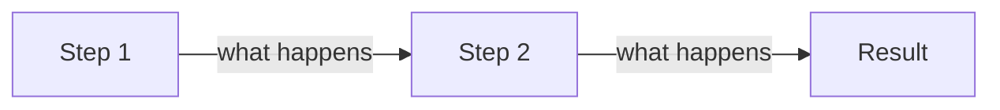

# <NN>. <Concept name>

> **Subject:** <JavaScript> · **Lesson:** <NN> · **Made:** <YYYY-MM-DD> · **Status:** ready
> **You will be able to:** <one sentence, e.g. "say what happens in memory when you write let x = 5, and why var behaves differently">
> **Before this:** [<previous lesson>](<file>.md) · **Next:** [<next lesson>](<file>.md)

## 1. The idea in one sentence

<One plain sentence. No jargon. If a term is needed, define it right here.>

## 2. The picture

<What to notice in the diagram, in one line.>



<Mermaid rules: use `graph LR` or `graph TB` (never `flowchart`), `sequenceDiagram` for flows over time. Edge labels only `-->|label|` with no colons and no commas inside. No parentheses in node labels. No `<-->`.>

## 3. Real life analogy

<One short analogy, then one line on where the analogy stops being true.>

## 4. The smallest code that shows it

```js
// Keep it under 15 lines. Comments show the value at each step.
```

**Output:**

```
<exact output>
```

## 5. What really happens, step by step

<Trace the engine. A table works best: one row per step, columns for what changes (memory, call stack, queue, value).>

| Step | Code line | What the engine does | State after |
|---|---|---|---|
| 1 | | | |
| 2 | | | |

## 6. Why it exists and what it costs

- **Problem without it:** <what breaks>
- **How it solves it:** <one or two lines>
- **Cost or tradeoff:** <when not to use it, what it costs>

## 7. Common mistakes

**Wrong:**

```js
```

**Right:**

```js
```

**Why:** <one line>

## 8. Watch and play

<2 to 4 links, each checked to be real and working on the day the lesson was made. Prefer a short video, an interactive visualizer, and one doc page with good diagrams. Say why each is worth opening.>

- **Video:** [<title>](<url>) <channel, length> - <what it shows>
- **Play with it:** [<tool>](<url>) - <what to try, e.g. "paste the code from section 4 and step through it">
- **Read:** [<page>](<url>) - <which part>

## 9. Practice

**A. Predict the output** (write your answer before opening)

```js
```

<details><summary>Answer</summary>

<answer and one line why>

</details>

**B. Fix the bug**

```js
```

<details><summary>Answer</summary>

</details>

**C. Write it yourself**

<small task, ideally a runnable file under `practice/` in this subject folder with a test>

<details><summary>One possible answer</summary>

</details>

## 10. Interview question

**Q:** <the way an interviewer would ask it>

<details><summary>A strong answer, in four parts</summary>

1. **Problem:** <what it solves>
2. **How it works:** <the mechanism, the picture in words>
3. **Tradeoff:** <cost, when not to use>
4. **My example:** <where it shows up in DBO, Unloan, ZWS or Skyworx work, only true facts>

</details>

## 11. Explain it back

Close this file. Explain the concept out loud like to a new junior, in 4 parts (problem, how, tradeoff, my example). Then write your best version below and run `/explain-check <concept>` or ask the `explain-coach` agent to review it.

### My explanation

<write here>

### Coach feedback

<the explain-coach agent writes here>

## 12. Review questions (day 1, 3, 7, 21)

1. <question>
2. <question>
3. <question>
4. Draw the picture from section 2 from memory.

<details><summary>Answers</summary>

1.
2.
3.

</details>

## Connected lessons

- [<lesson>](<file>.md) - <how it connects>
